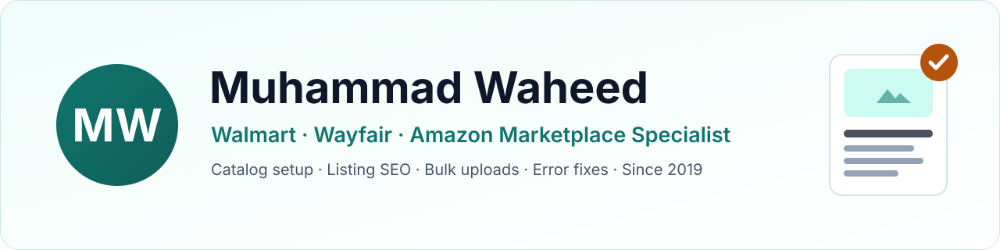

<picture>
  <source media="(prefers-color-scheme: dark)" srcset="assets/banner-dark.svg">
  
</picture>

  
  
  

## 👋 Hi, I'm Muhammad

I help US and UK brands **list, fix and grow their products on Walmart, Wayfair and Amazon**: clean catalogs, published items, fewer errors, and stock that stays in sync across every channel. I've worked remotely as an e-commerce marketplace specialist since 2019.

- 🛒 Accounts I've worked in: **11** Amazon brand accounts · **8** Walmart seller accounts · **5** Wayfair supplier accounts
- 📦 Largest catalog: **7,065 Walmart SKUs** organized into **19** variant groups
- 🟢 **Open to new projects.** [Message me on Upwork](https://www.upwork.com/freelancers/~01b327cb277ce36115)

## 🧰 What I can do for you

| Area | What I handle |
| --- | --- |
| **Walmart Seller Center** | Item setup, bulk uploads, variant groups, item errors and reports, image and content updates, Listing Quality, GTIN exemptions, brand documents |
| **Wayfair Partner Home** | Product templates, specs and attributes, variations, image updates and support cases for Wayfair US and UK |
| **Amazon Seller Central** | Listings and flat files, parent-child variations, Brand Registry, A+ Content, suppressed and stranded listings |
| **Listing SEO** | Keyword research with Helium 10, then titles, bullets, descriptions and attributes written to rank and convert |
| **Catalog audits & bulk fixes** | Finding and fixing errors across hundreds or thousands of SKUs with spreadsheets and bulk templates |
| **More channels** | Shopify, eBay, TikTok Shop, Faire and Mirakl marketplaces such as Best Buy and Nordstrom |

## 📊 Selected work

Client names are kept private.

- **Walmart catalog build:** 7,065 SKUs organized into 19 variant groups
- **Catalog audit:** 160 SKUs reviewed and 60 problem items found and prioritized
- **Bulk maintenance:** a 938-row update file prepared for upload
- **Image update:** new images rolled out across 109 SKUs

## 🚀 Projects

- **[Listing Optimizer](https://muhammadwaheed37.github.io/listing-optimizer/)**: a free tool that checks Amazon, Walmart, eBay and Etsy listings in your browser. It flags character and byte limits, policy problems and missing keywords, then gives you a copy-ready audit report. ([code](https://github.com/MuhammadWaheed37/listing-optimizer))
- **[Portfolio website](https://muhammadwaheed37.github.io/)**: my services, selected work and how I work. ([code](https://github.com/MuhammadWaheed37/muhammadwaheed37.github.io))

## 🤝 How I work

1. I start with a quick review of your account, catalog and errors.
2. You get a short plan with priorities, so the fixes that matter most come first.
3. I keep you updated with a simple tracker in Google Sheets.
4. Your data and account access stay confidential.

## 🛠️ Marketplaces & tools

  
  
  
  
  
  
  
  
  
  
  

## 📫 Let's work together

Tell me your store, the marketplaces you sell on, and what you want fixed or launched. I'll reply with the first steps.

**[→ Message me on Upwork](https://www.upwork.com/freelancers/~01b327cb277ce36115)** · **[→ Visit my website](https://muhammadwaheed37.github.io/)**
